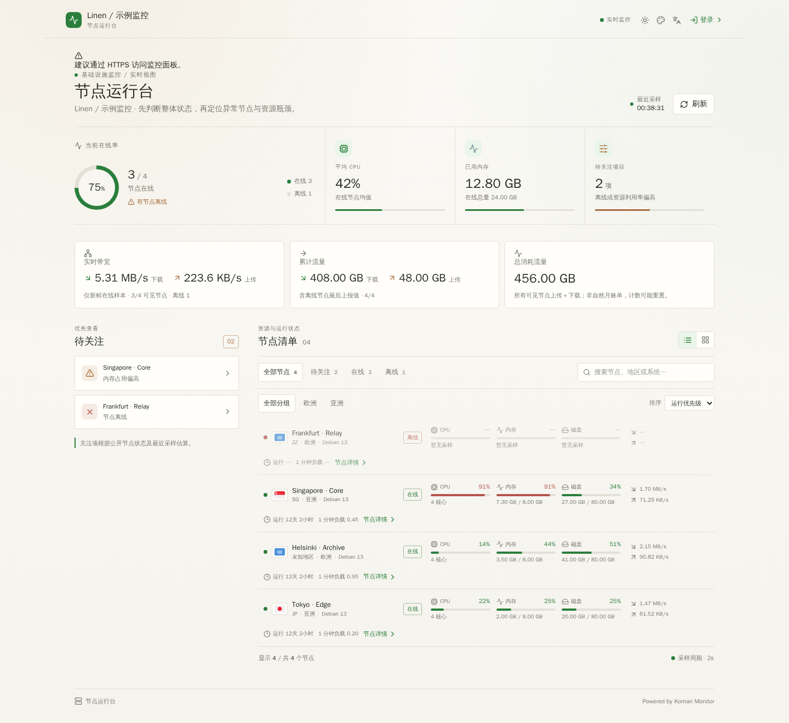
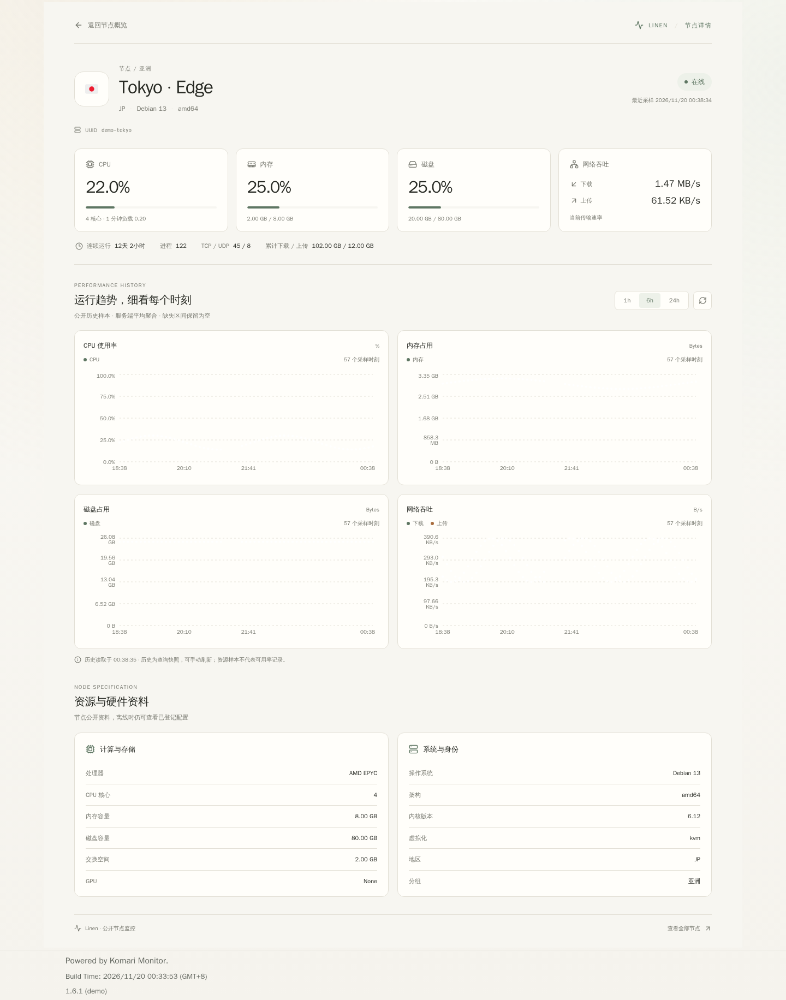
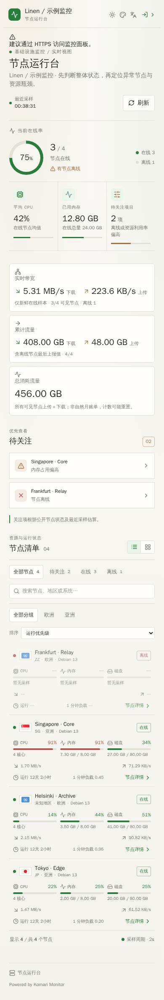

# Linen · 节点运行台



Linen 2.1 是面向 Komari Monitor 1.6.1 的独立监控主题。首页与节点详情使用新组件和新布局，按“整体状态 → 待关注节点 → 资源清单 → 历史趋势”组织信息。

## 展示

以上及下方图片来自真实浏览器渲染，使用固定的**演示节点与模拟指标**，不含线上机器资料。

### 节点详情



<details>
<summary>暗色模式与手机布局</summary>




</details>

## 功能

- 独立导航、当前在线率、在线节点 CPU/内存汇总与待关注队列。
- 主题设置新增“显示优先查看”开关，默认开启；关闭后节点清单自动铺满。
- 实时视图显示上下行速率、累计上传/下载和总消耗流量。
- 按状态和分组筛选，搜索节点/地区/系统，按资源占用排序，列表/网格视图切换。
- 独立详情页：当前 CPU、内存、磁盘、网速、运行时间、硬件资料。
- CPU、内存、磁盘及上下行历史曲线，支持 1/6/24 小时时段与刷新，缺失样本保留断点。
- 区分首次加载、离线、断连和超过 30 秒的过期采样；无有效样本时显示 —，不把缓存值当当前读数。
- 亮暗模式、可切换强调色、中文/英文与响应式布局。

当前在线率是当前状态快照，并非历史 SLA。待关注项由可见节点与资源阈值计算，不代替 Komari 后台告警。

### 优先查看与流量口径

- 在 Komari 后台的 Linen 主题设置中切换“显示优先查看”。它只控制左侧区域，关闭后仍可通过“待关注”筛选节点。
- 实时带宽按当前面板所有可见、在线且采样新鲜的节点汇总上下行速率，使用 B/s、KB/s、MB/s；不会随下方搜索或分组筛选改变。
- 累计流量保留离线节点的最后上报计数；总消耗流量 = 已知累计上传 + 已知累计下载。计数可能因 Agent/系统重启或重置而变化，不代表自然月账单。
- 部分节点或方向缺失时明确标记“部分数据缺失/仅已知部分”，缺测显示 —，真实的零仍显示为 0。

### 2.1 修复记录

- 修复手机国旗外边距与固定尺寸冲突，补充缺失地区、未知代码和图片失败回退。
- 修复平板宽度隐藏节点网速、切换语言导致未分组筛选失效。
- 修复缺测被当作 0、节点清单瞬时失败丢失缓存和刷新按钮提前结束。
- 修复稀疏历史样本只有孤立点时图表不可见；保留缺失区间断线。
- 修复主题/设置刷新导致首页状态重置、空清单被标为健康等边界状态。

## 安装与升级

1. [下载 Linen 2.1.0 主题包](release/komari-theme-linen-2.1.0.zip)。请下载 ZIP 文件本身，不要上传 GitHub 的源码压缩包。
2. 登录 Komari 后台，进入“主题管理”，上传或更新 Linen。
3. 对新安装主题选择“设为当前主题”，然后刷新首页。

**升级提示：**主题标识仍为 Linen。若你已经启用了旧版 Linen，更新同名主题文件可能立即改变线上页面。先保留 [2.0.0 主题包](release/komari-theme-linen-2.0.0.zip) 作为回滚副本。主题更新不需要升级 Komari 服务端或 Agent。

### 刷新与回滚

- 更新后刷新首页；若仍看到旧界面，尝试强制刷新。已安装的 PWA 可关闭所有站点窗口后重新打开。
- 回滚时，在“主题管理”中上传先前保留的同名 Linen 主题包。当前主题为 Linen 时，恢复文件后即可使用旧界面。
- 自行从宿主机维护主题目录时，先备份整个旧目录，在同一文件系统中准备并校验新目录，再原子替换；不要直接覆盖运行中的零散资源文件。

## 从源码构建

要求 Node.js 22 或更新版本、npm 和 Python 3。

```sh
npm ci --no-audit --no-fund
npm run build
python3 scripts/package-theme.py
```

输出为 release/komari-theme-linen-2.1.0.zip。主题包只包含根目录清单、PNG 预览及 dist/ 资源；不含源码和 node_modules。完整前端构建占用较多内存，低内存主机请优先下载预构建包。

## 浏览器验证

```sh
npm install --no-save --package-lock=false playwright
npx playwright install --with-deps chromium
# 终端一：仅启动本机预览
npm run dev -- --host 127.0.0.1 --port 4179 --strictPort
# 终端二：拦截 API，使用演示数据验证，不会修改后端
node --experimental-strip-types scripts/test-linen-network.mjs
node scripts/qa-linen-browser.mjs
```

测试覆盖筛选、搜索、排序、列表/网格、详情跳转、历史时段、明暗模式、320–1440px 多档页面宽度、首载、空清单、断连、过期/缺失样本、主题开关和异常国旗，并生成 docs/ 中的实际截图。

## 实现与兼容

- 独立首页：src/components/linen/LinenDashboard.tsx 与对应 CSS。
- 独立详情：src/components/linen/LinenInstance.tsx 与对应 CSS。
- 基于官方 komari-web 1.6.1 的数据上下文和 RPC2 客户端；首页读取公共节点数据，历史图通过 public:queryMetrics 查询。
- 管理后台与终端仍由 Komari 内置界面提供，主题不绕过管理员认证。
- 保留服务器标题/描述占位符以及自定义 head/body 注入。
- 后台主题设置提供“显示优先查看”、桌面/手机背景、内容宽度与自定义页脚。其他旧版首页专用设置已移除。
- [官方主题文档](https://komari-document.pages.dev/dev/theme) · [上游前端 1.6.1](https://github.com/komari-monitor/komari-web/tree/1.6.1)
