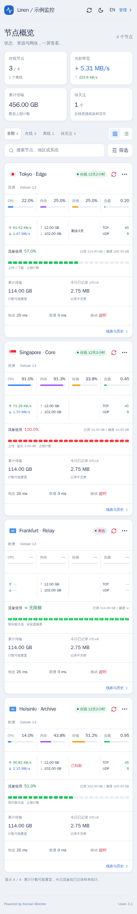
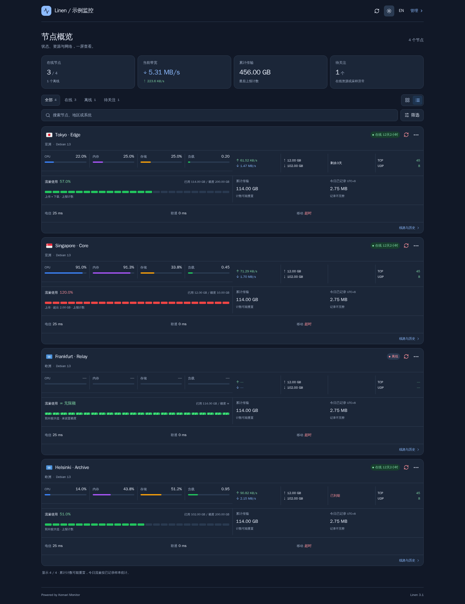

# Linen · 清朗


为 Komari Monitor 1.6.1 重写的公开监控主题。**3.0 从页面结构重新实现**，首页和详情使用同一个节点卡片组件、同一个页面壳层和一套独立样式，替代旧版各页面单独拼装的界面。

## 界面

- 浅灰蓝背景、白色 12px 圆角卡片、深蓝文字和细分隔线；手机与桌面使用同一套视觉规则。
- CPU 蓝、内存紫、存储黄、上行绿、下行蓝，24 段额度条和真实采样状态灯。
- 首页由简洁概览、状态筛选、搜索、分组/排序与节点卡片组成。列表与卡片视图可切换并记忆选择。
- 点开节点后展开同一张卡片，附加线路观测、系统资料与历史曲线，不再切换成另一种页面风格。
- 适配 320–1440px、明暗模式和中英文。以下均为真实浏览器渲染的**演示数据截图**，不是线上节点资料。

### 手机卡片



### 节点详情


<details>
<summary>暗色和紧凑列表</summary>




</details>

## 安装与在线更新

在 Komari 后台「主题管理 → 从 URL 导入」中填入仓库地址：

```text
https://github.com/MechanicF/komari-theme-linen
```

确认覆盖同名主题 **Linen**。此后点击主题管理的「更新」，即可读取仓库最新 Release 的安装 ZIP。

也可 [下载最新安装包](https://github.com/MechanicF/komari-theme-linen/releases/latest) 后手动上传。请上传 Release 附件中的主题 ZIP，**不要上传 GitHub 的源码压缩包**。

旧版缺少来源 URL 时，需要从上述 URL 导入或手动上传覆盖一次，才能接上更新。更新前建议保留 [3.0.0 安装包](https://github.com/MechanicF/komari-theme-linen/releases/tag/v3.0.0) 作为回滚副本。已启用 Linen 时，更新同名主题可能立即改变公开页面。刷新仍旧时请强制刷新；PWA 可关闭全部站点窗口后再打开。

### 自定义主题市场

在「市场 → 主题市场 → 市场源」中添加：

```text
https://raw.githubusercontent.com/MechanicF/komari-theme-linen/main/market.json
```

此为本仓库自定义市场源，未宣称收录于官方默认市场。打包脚本会更新版本、Release ZIP 地址和 SHA-256；发布时须把安装 ZIP 附加到对应 GitHub Release，并保持为第一个附件。

## 数据与文案口径

- **当前状态**：实时读数仅显示新鲜在线样本；首载、缺样本、断连和过期分别显示，缺测不作 0。最近 30 秒之外的在线采样不视为当前读数。
- **待关注**：只查看在线节点资源占用偏高或采样问题，与离线分类分开。
- **流量额度**：按节点配置的 up/down/sum/min/max 口径计算。未设置额度时显示“∞ 无限额”完整分段条；超额会提示，条形最多填满。累计计数并不自动等于月度账单。
- **累计传输**：最后上报的累计上传＋下载；离线可以保留历史计数，Agent/系统重启或计数重置可能使其变化。
- **今日已记录**：按设置的 UTC+8（默认）或 UTC 自然日 00:00 起，汇总公共 traffic.up/down 字节增量。每分钟批量刷新；缺记录、查询失败和记录不完整均有提示，不通过瞬时网速推造日流量，不是精确账单。
- **到期/续费**：只在有效日期或价格配置存在时显示；不足一天按一天显示，到期显示「已到期」。不虚构免费、价格和到期日期。
- **三网/线路**：使用已有公开测速任务与 ping.latency_ms 采样，区分有效值、超时、缺测和过期。电信、联通、移动三栏均须在后台填写各自使用的公开检测任务 ID，留空显示“未配置”，不自动按名称选任务。详情支持运营商与地区选择。
- **路由和带宽测速**：当前后端没有公开的去/回程路由及带宽测速接口，对应读数明确为 —，测速按钮不可用。「刷新线路记录」仅重新读取已有公共采样，不发起新探测。采样灯表示最近 24 个已返回位置，缺失槽为灰色。
- **历史曲线**：公开指标快照，缺失区间保留断点并显示孤立样本，不据此宣称历史 SLA。

## 后台设置

保留当前布局确实使用的显示开关：概览状态、带宽、累计总量、待关注筛选，以及节点地区/系统/分组、资源读数、网速、运行时间、流量、到期和三网。3.0 移除了旧布局专属的 CPU/内存概览卡、侧边队列及单独累计方向概览设置；旧设置值留在后端不会改变新页面。

支持公开页宽度、桌面/手机背景、自定义页脚。节点名称、状态和详情入口始终保留；隐藏字段不会改写额度、监控采集或异常判断。

Komari 的管理后台与终端由服务端内置界面提供，不由主题替换。主题保留严格的标题/描述占位符及自定义 head/body 注入，不绕过管理员认证。

## 构建

Node.js 22+、npm、Python 3：

```sh
npm ci --no-audit --no-fund
npm run build
python3 scripts/package-theme.py
```

输出：release/komari-theme-linen-3.1.0.zip 与 market.json。源码和 node_modules 不会加入安装包。前端构建有较高内存需求，低配置主机建议直接下载预构建主题 ZIP。

### 回归验证

```sh
node --experimental-strip-types scripts/test-clear-data.mjs
node scripts/test-linen-carrier.mjs
node --experimental-strip-types scripts/test-linen-traffic.mjs
# 安装 Playwright 后准备 Chromium
npm install --no-save --package-lock=false playwright
npx playwright install --with-deps chromium
# 终端一
npm run dev -- --host 127.0.0.1 --port 4179 --strictPort
# 终端二
node scripts/qa-clear-browser.mjs
```

测试拦截公共接口并使用固定演示数据，不修改服务器。覆盖筛选、分组、排序、双视图、暗色、手机布局、详情跳转、刷新、历史时段、稀疏样本、线路、到期/额度、权限失败、缺测与断连。

## 源码

- 新公开页面和唯一设计系统：src/components/clear/。
- 共享卡片：NodeCard.tsx。概览与详情直接引用同一个组件。
- Page.tsx 提供统一壳层与公开页数据；Routes.tsx 和 History.tsx 提供独立的线路/历史区域。
- 继续使用经过测试的 Komari RPC2、公共节点/实时上下文、自然日增量及额度计算适配层；旧公开界面组件不再由路由或样式入口加载。

[Komari 主题规范](https://komari-document.pages.dev/dev/theme) · [上游前端 1.6.1](https://github.com/komari-monitor/komari-web/tree/1.6.1)

### 3.1 卡片对齐与手动检测来源

- 在“Linen 主题设置”中填写电信／联通／移动各栏使用的公开延迟任务 ID，编号来自 Komari 后台延迟任务列表。任务名不必含运营商字样；同一个任务也可以在多个栏位复用。旧的自动匹配已取消。
- 未填写显示“未配置”，ID 已填写但无记录显示“暂无数据”；不会把未配置误当作超时。
- 卡片各信息区使用一致高度，缺少价格或到期日不再使卡片长短不一；开关仍可统一隐藏字段。
- 没有配置流量额度时显示“∞ 无限额”完整条。这只说明面板未配置额度，不是服务商提供无限流量的承诺；有额度但缺计数时依旧未知。
