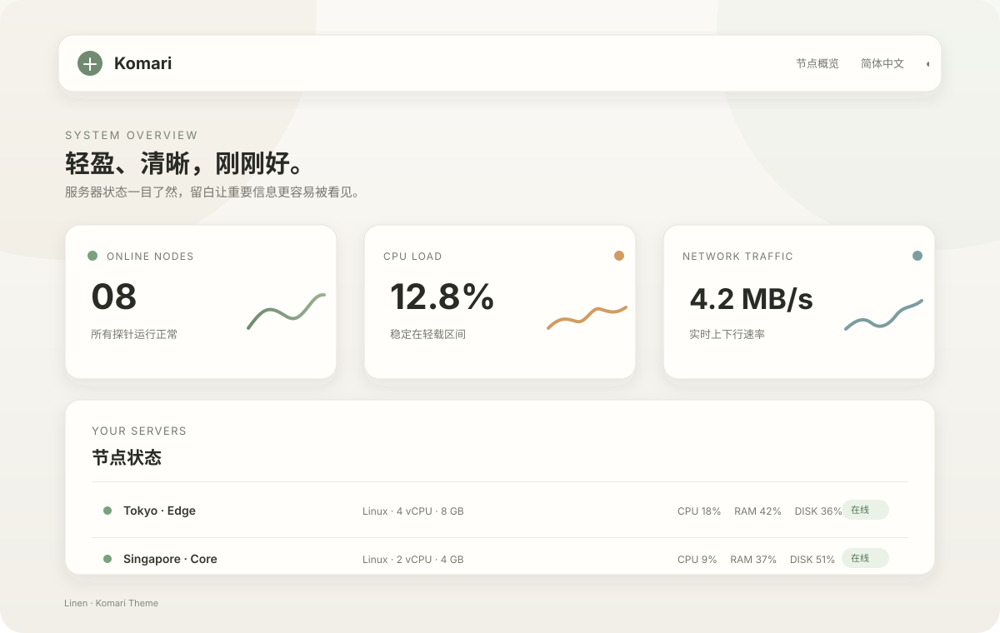

# Linen 暖白 · Komari Theme



为 Komari Monitor 1.6.1 制作的暖白极简主题：暖象牙白底色、柔和鼠尾草绿、克制的卡片阴影与清晰的数据层级。支持亮/暗模式、强调色切换、移动端布局及后台原有主题设置；仅调整视觉，不改监控数据、API、路由或认证逻辑。

## 预览

- 主题：Linen 暖白（Linen）
- 版本：1.0.0
- 适配面板：Komari 1.6.1

## 安装

1. [下载主题包](release/komari-theme-linen-1.0.0.zip)。
2. 登录 Komari 管理后台，打开“主题管理”。
3. 上传 ZIP，预览后选择“Linen 暖白”并应用。

上传/应用主题前，当前活动主题不会改变。

## 从源码构建

要求 Node.js 22 或更新版本。在仓库根目录运行：

```sh
npm ci --no-audit --no-fund
npm run build
python3 scripts/package-theme.py
```

生成包：release/komari-theme-linen-1.0.0.zip。打包程序会检查归档，并只收录主题清单、预览图和 dist/ 资源。

## 自定义

主要样式位于 src/linen-theme.css。默认背景图片和主内容宽度仍可通过 Komari 主题设置调整；PWA 颜色与暖白页面配色一致。

## 兼容与文档

- 前端基于 Komari 官方 komari-web 1.6.1 tag 构建，以保留与当前服务器一致的页面功能和接口。
- 保留 Komari 服务器要求的标题、描述模板，及自定义 head/body 注入能力。
- 官方主题开发指南：[komari-document.pages.dev/dev/theme](https://komari-document.pages.dev/dev/theme)
- 上游前端源码：[komari-monitor/komari-web 1.6.1](https://github.com/komari-monitor/komari-web/tree/1.6.1)
